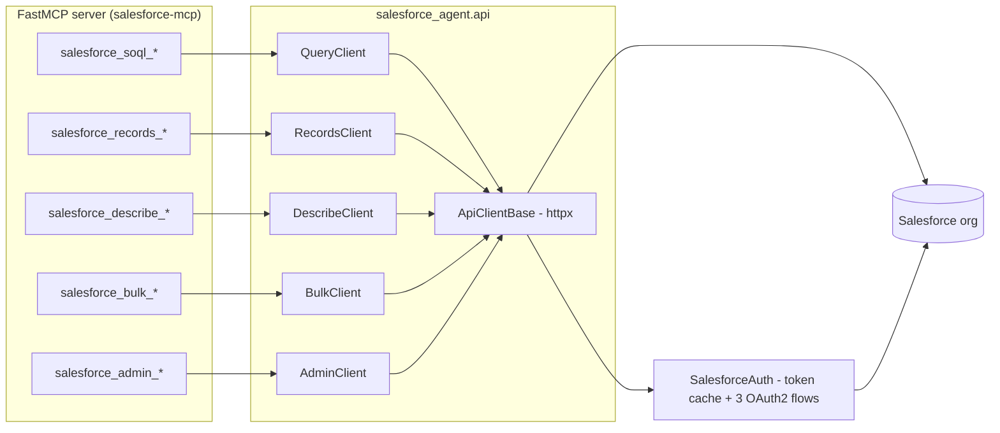

# Overview

## Architecture

Operation tools are named `salesforce_<resource>_<operation>` and take typed arguments; no tool takes an `action`.

| Resource | Tools |
|----------|-------|
| Query | `salesforce_soql_query`, `salesforce_soql_explain`, `salesforce_soql_search` |
| Records | `salesforce_records_get`, `_create`, `_update`, `_upsert`, `_delete`*, `_composite`, `_collections_create`, `_collections_update`, `_collections_delete`* |
| Describe | `salesforce_describe_global_describe`, `_sobject`, `_record_counts`, `_limits` |
| Bulk API 2.0 | `salesforce_bulk_create_ingest_job`, `_upload`, `_close`, `_abort`, `_status`, `_list_jobs`, `_delete_job`, `_results` |
| Admin | `salesforce_admin_user_info`, `_org_info`, `_list_reports`, `_run_report` |
| Graph | `salesforce_ingest_crm` |
 by `SALESFORCE_ALLOW_DESTRUCTIVE` (default `False`).

`*` gated by `SALESFORCE_ALLOW_DESTRUCTIVE` (default `False`).

## Auth-flow matrix

| Flow | Required settings | Token endpoint | Notes |
|------|-------------------|----------------|-------|
| `client_credentials` | `SALESFORCE_CLIENT_ID`, `SALESFORCE_CLIENT_SECRET`, `SALESFORCE_INSTANCE_URL` | My Domain `/services/oauth2/token` | Salesforce requires the My Domain host for this flow |
| `refresh_token` | `SALESFORCE_REFRESH_TOKEN`, `SALESFORCE_CLIENT_ID` (+ secret if the app requires it) | login URL or My Domain | instance URL taken from the token response |
| `jwt_bearer` | `SALESFORCE_CLIENT_ID`, `SALESFORCE_JWT_SUBJECT`, `SALESFORCE_JWT_PRIVATE_KEY[_PATH]` | login URL (`aud` claim) | needs the `jwt` extra (`cryptography`) |
| `access_token` | `SALESFORCE_ACCESS_TOKEN`, `SALESFORCE_INSTANCE_URL` | none | static; no refresh-on-401 |

The flow is auto-detected from the credentials present, or pinned with
`SALESFORCE_AUTH_FLOW`. `SALESFORCE_SANDBOX=true` switches the default login
host to `https://test.salesforce.com`. Tokens are cached with expiry
(`expires_in` when returned, else `SALESFORCE_TOKEN_TTL_SECONDS`) and the
HTTP layer retries exactly once on 401 after invalidating the cache.
